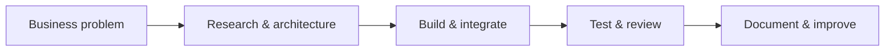

# Rahul Chamoli · Kaizen-Ryu

### AI Engineer & Cloud Consultant

I build practical AI assistants, APIs and automation with Microsoft Azure, Python and FastAPI. My focus is turning a business problem into a maintainable product, with clear architecture, useful documentation and security considered throughout.

[Visit my portfolio](https://kaizenxryu.github.io/) · [Connect on LinkedIn](https://www.linkedin.com/in/rahulchamoli/) · [Explore my GitHub](https://github.com/KaizenxRyu)

## What I work on

| Area | Focus |
| :--- | :--- |
| **AI applications** | Assistants, retrieval, local models and integrations with tools |
| **Cloud & automation** | Azure, Microsoft 365, PowerShell and repeatable workflows |
| **Product engineering** | Python APIs, FastAPI, structured delivery and maintainable code |
| **AI security** | Building knowledge in secure AI applications, data protection and responsible tool access |

## Project experience

My project work spans identity automation, enterprise AI assistants, application packaging, virtual desktop operations, cloud cost reporting and data security.

[Explore my portfolio](https://kaizenxryu.github.io/#projects) for anonymized project summaries. Company and customer source code stays private.

## Building Kaizen-Ryu

Kaizen-Ryu is my ongoing exploration of a local AI workspace: one place to understand projects, work with coding agents, organize knowledge and review results.

Current interests include specialist local models, searchable project knowledge, meeting assistance and evidence-driven development. This work is in progress; public demos and case studies will be shared as they are ready.

## Toolbox

**Python · FastAPI · PowerShell · Microsoft Azure · Azure AI · Microsoft 365 · Git · GitHub**

## Work with me

Have a workflow that needs automation, an AI assistant to build, or an Azure application to improve?

[Email me](mailto:rahulchamoli.in%2Bhello@gmail.com) or [message me on LinkedIn](https://www.linkedin.com/in/rahulchamoli/) with your business problem, current environment and expected outcome.

Kaizen: continuous improvement, one useful change at a time.
